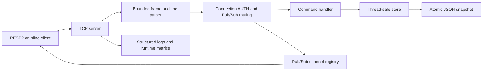

# Mini Redis

Mini Redis is a small Redis-inspired database built with Python's standard library. It is an educational project for exploring storage engines, TTL, JSON snapshots, RESP2, TCP concurrency, publish/subscribe, and simple server security. It does not aim to provide full Redis compatibility or production-grade security.

## Milestones

| Milestone | Status | Scope |
|---|---|---|
| V1 | Complete | In-memory string key/value storage. |
| V2 | Complete | Command parsing, dispatch, and argument validation. |
| V3 | Complete | TCP server and newline-delimited inline commands. |
| V4 | Complete | RESP2 command arrays and response types. |
| V5 | Complete | Key TTL, EXPIRE, TTL, and lazy expiration. |
| V6 | Complete | Atomic JSON snapshots and restart recovery. |
| V7 | Complete | MSET, MGET, DBSIZE, and KEYS *. |
| V8 | Complete | Lists, sets, hashes, type checks, expiration, and typed snapshots. |
| V9 | Complete | Concurrent clients, synchronized storage, size limits, and graceful shutdown. |
| V10 | Complete | SUBSCRIBE, UNSUBSCRIBE, and PUBLISH with RESP2 message arrays. |
| V11 | Complete | Optional connection-scoped AUTH. Disabled by default. |
| V12 | Complete | Logging, CLI configuration, INFO/STATUS metrics. |
| V13 | Complete | Reproducible standard-library benchmark runner. |
| V14 | Complete | Python package entry points, Docker files, GitHub Actions, and project documentation. |

## Architecture



Each TCP client is handled by a worker thread. The server identifies a RESP2 array or an inline line, validates its size, applies connection-level authentication and Pub/Sub behavior, and forwards ordinary commands to `CommandHandler`. The handler validates arguments and calls the shared `MiniRedisStore`. Store operations use a reentrant lock; snapshot creation holds the same lock while converting the active state to JSON and atomically replacing the previous file. Pub/Sub uses a separate locked channel registry and per-client message queues, so a quiet subscriber does not occupy the accept loop.

## Project structure

```text
Redis/
├── .github/workflows/tests.yml   # CI test matrix
├── .dockerignore
├── .gitignore
├── Dockerfile
├── README.md
├── pyproject.toml                 # package metadata and CLI entry points
├── miniredis_data.json            # local default snapshot (ignored by Git)
├── miniredis/
│   ├── __init__.py                # public exports (server imported lazily)
│   ├── __main__.py                # python -m miniredis
│   ├── benchmark.py               # local benchmark runner
│   ├── commands.py                # command validation and store dispatch
│   ├── persistence.py             # versioned JSON snapshots
│   ├── pubsub.py                  # thread-safe channel registry
│   ├── resp.py                    # RESP2 parser and encoders
│   ├── server.py                  # concurrent TCP server, CLI, auth and metrics
│   └── store.py                   # synchronized typed storage and TTL
└── tests/                         # unit, persistence, protocol and integration tests
```

## Requirements and installation

- Python 3.10 or newer.
- No third-party runtime dependencies.
- Optional: Docker and `redis-cli` for the corresponding workflows below.

From the project directory:

```bash
python3 -m venv .venv
source .venv/bin/activate
python -m pip install .
```

Or run directly from the checkout without installing:

```bash
python3 -m miniredis --help
```

## Start and configure the server

```bash
python3 -m miniredis
```

Defaults are host `127.0.0.1`, port `6379`, snapshot `./miniredis_data.json`, 1 MiB maximum request size, and INFO logging. `Ctrl-C` shuts the server down and saves a final snapshot. Use `--help` for the full option list.

```bash
python3 -m miniredis --host 127.0.0.1 --port 6380 \
  --persistence-file /tmp/mini-redis-demo.json \
  --max-request-size 2097152 --client-timeout 60 --log-level DEBUG
python3 -m miniredis 6380                  # legacy positional port form
python3 -m miniredis --no-persistence
```

The server can also be started with `python3 -m miniredis.server`; lazy package exports avoid the previous runpy warning. `MINIREDIS_PASSWORD` enables AUTH when set. Use `--password-env NAME` to select a different environment variable. Do not put secrets in shell command arguments or commit them.

## Command reference

RESP2 replies use integers for counts and booleans, bulk strings for values, null bulk strings for absent values, arrays for multi-value replies, simple strings for statuses, and error frames for rejected commands.

| Commands | Syntax | Result |
|---|---|---|
| `PING` | `PING [message]` | PONG or the one provided message. |
| `SET`, `GET` | `SET key value [EX seconds]`; `GET key` | Store/retrieve a string; GET of a missing/expired key is null. SET replaces other types and clears an old TTL unless EX is supplied. |
| `DEL`, `EXISTS` | `DEL key`; `EXISTS key` | Integer 1 or 0. |
| `EXPIRE`, `TTL` | `EXPIRE key seconds`; `TTL key` | Set TTL (nonpositive removes the key); TTL returns -2 missing, -1 persistent, or remaining seconds. |
| `MSET`, `MGET` | `MSET key value [key value ...]`; `MGET key [key ...]` | MSET clears prior TTLs; MGET preserves input order and returns null for missing/expired keys. |
| `DBSIZE`, `KEYS` | `DBSIZE`; `KEYS *` | Active key count; sorted active keys. Only `*` is supported. |
| `LPUSH`, `RPUSH` | `LPUSH key value [value ...]`; `RPUSH key value [value ...]` | Push values at either end and return resulting length. |
| `LPOP`, `RPOP`, `LRANGE`, `LLEN` | `LPOP key`; `RPOP key`; `LRANGE key start stop`; `LLEN key` | Pop from an end, inclusive range, or length. Negative range indexes count from the tail. |
| `SADD`, `SREM` | `SADD key member [member ...]`; `SREM key member [member ...]` | Return newly added or removed member count. |
| `SMEMBERS`, `SISMEMBER`, `SCARD` | `SMEMBERS key`; `SISMEMBER key member`; `SCARD key` | Sorted members, membership integer, and set cardinality. |
| `HSET`, `HGET`, `HGETALL` | `HSET key field value [field value ...]`; `HGET key field`; `HGETALL key` | Add/update fields, fetch a field, or return sorted field/value pairs. |
| `HDEL`, `HLEN` | `HDEL key field [field ...]`; `HLEN key` | Return removed field count or hash length. |
| `PUBLISH` | `PUBLISH channel message` | Number of currently subscribed clients queued for delivery. |
| `SUBSCRIBE`, `UNSUBSCRIBE` | `SUBSCRIBE channel [channel ...]`; `UNSUBSCRIBE [channel ...]` | Connection-scoped subscriptions and RESP2 subscription acknowledgements. |
| `AUTH` | `AUTH password` | Authenticate this connection when server authentication is enabled. |
| `INFO`, `STATUS` | `INFO`; `STATUS` | Bulk string with uptime, client count, command counts, and Pub/Sub channel count. |

Each key has one type. A type mismatch returns `WRONGTYPE`. Removing the last list item, set member, or hash field removes that key. All types support EXPIRE/TTL. Lists retain push order; set members and hash fields are returned deterministically sorted.

## RESP2 examples

Start the server, then connect with `redis-cli`:

```text
redis-cli -h 127.0.0.1 -p 6379
127.0.0.1:6379> MSET name "Ada Lovelace" city "New York"
OK
127.0.0.1:6379> MGET city missing name
1) "New York"
2) (nil)
3) "Ada Lovelace"
127.0.0.1:6379> RPUSH jobs first second
(integer) 2
127.0.0.1:6379> SMEMBERS roles
1) "admin"
2) "reader"
127.0.0.1:6379> HGETALL user
1) "city"
2) "New York"
3) "name"
4) "Ada Lovelace"
```

RESP2 commands are arrays of bulk strings, so values containing spaces remain a single argument. Example using the project codec:

```python
import socket
from miniredis.resp import encode_array

with socket.create_connection(("127.0.0.1", 6379)) as client:
    client.sendall(encode_array(["MSET", "greeting", "hello world", "city", "New York"]))
    print(client.recv(1024))
```

### Legacy inline protocol

The server also accepts newline-delimited commands. Existing SET behavior is retained: the remainder after the key is its value. Other multi-argument inline commands use shell-style quoting for values containing spaces.

```text
nc 127.0.0.1 6379
SET note this value retains spaces
OK
MSET greeting "hello world" city "New York"
OK
MGET city missing greeting
1) New York
2) (nil)
3) hello world
LPUSH jobs "first job" "second job"
2
HSET user name "Ada Lovelace"
1
```

Inline arrays are displayed as numbered lines, and empty arrays as `(empty array)`. RESP2 is recommended for programmatic clients.

### Pub/Sub

Use two clients. The subscriber stays connected while other workers continue to serve normal commands:

```text
redis-cli -h 127.0.0.1 -p 6379
SUBSCRIBE updates alerts
```

In another terminal:

```bash
redis-cli -h 127.0.0.1 -p 6379 PUBLISH updates "deployment complete"
```

SUBSCRIBE and UNSUBSCRIBE acknowledgements are RESP2 arrays such as `['subscribe', 'updates', 1]`; messages are `['message', 'updates', 'deployment complete']`. Disconnected subscribers are removed. Delivery is in-memory and is not persisted.

### TTL and persistence

```text
SET temporary "short lived" EX 30
TTL temporary
EXPIRE temporary 10
```

JSON snapshots use schema version 2 and preserve all four value types and remaining TTL. Snapshot writes are atomic and happen after successful mutations plus clean shutdown. Version 1 string snapshots remain readable. Expired values are filtered when loading after downtime. The default snapshot path is relative to the server's current working directory; choose a separate path for demos/tests. Passwords, Pub/Sub channels, and messages are not persisted.

Restart verification with `redis-cli`:

```bash
redis-cli -h 127.0.0.1 -p 6379 MSET portfolio "Mini Redis" status "saved"
redis-cli -h 127.0.0.1 -p 6379 RPUSH recent "V8 work" "V14 work"
# Stop the process with Ctrl-C, restart it in the same directory, then:
redis-cli -h 127.0.0.1 -p 6379 MGET portfolio status
redis-cli -h 127.0.0.1 -p 6379 LRANGE recent 0 -1
```

### Authentication and security limits

```bash
export MINIREDIS_PASSWORD='use-a-long-random-local-secret'
python3 -m miniredis --port 6379
redis-cli -h 127.0.0.1 -p 6379 AUTH 'use-a-long-random-local-secret'
```

Without the environment variable, authentication remains disabled. The server stores a SHA-256 digest and compares digests in constant time, but this educational scheme has no user database, rate limiting, password stretching, TLS, ACLs, or encrypted transport. AUTH credentials cross the network in cleartext; use only on a trusted local network. It is not suitable as production security.

## Docker

Build and run with persistent storage mounted outside the image:

```bash
docker build -t mini-redis .
docker run --rm -p 6379:6379 -v mini-redis-data:/data mini-redis
```

To enable AUTH, pass the secret through the container environment (avoid storing it in an image):

```bash
docker run --rm -p 6379:6379 -v mini-redis-data:/data \
  -e MINIREDIS_PASSWORD='use-a-long-random-local-secret' mini-redis
```

## Testing

Run the entire suite from the repository root:

```bash
python3 -m unittest discover -s tests -v
```

The TCP integration tests bind loopback ports. Socket-restricted sandboxes may raise `PermissionError`; rerun the same command in a local macOS terminal to verify those tests. Tests using `socket.socketpair()` and temporary directories do not touch the project snapshot. Do not use the checked-in/local `miniredis_data.json` as a disposable test file.

## Benchmarking

The benchmark prints actual machine/Python details, throughput, average latency, and p50/p95 latency where applicable. It includes string, multi-key, collection, concurrent-client, and persistence operations. Results depend on machine load and are not precomputed performance claims.

```bash
python3 -m miniredis.benchmark --iterations 10000 --clients 4
```

## Known limitations and future work

- This is a Redis-inspired learning server, not a Redis replacement. Command coverage and edge-case semantics are intentionally limited.
- Inline commands are text-oriented; RESP2 is preferable for values that require unambiguous argument boundaries.
- Persistence rewrites a full JSON snapshot after each successful mutation, which is simple but costly at scale. There is no append-only log or replication.
- Pub/Sub is process-local, volatile, and has no pattern subscriptions, persistence, or delivery acknowledgements.
- Authentication is a basic shared secret with no TLS or rate limiting and is not production-grade.
- The server uses one thread per client; it is suitable for small demos, not high-connection workloads.
- There are no transactions, Lua scripting, clustering, ACLs, or full Redis protocol compatibility.

Possible future work includes a write-ahead log, richer protocol limits, asynchronous networking, richer metrics, and a more complete compatibility suite.

## Before pushing to GitHub

Run locally:

```bash
python3 -m unittest discover -s tests -v
python3 -m miniredis --help
python3 -m miniredis.benchmark --iterations 1000 --clients 2
docker build -t mini-redis .  # if Docker is installed
git status --short
git diff --check
```

Initialize or update a Git repository and push only when you have reviewed the staged changes. Local snapshots and secrets are excluded by `.gitignore`.
